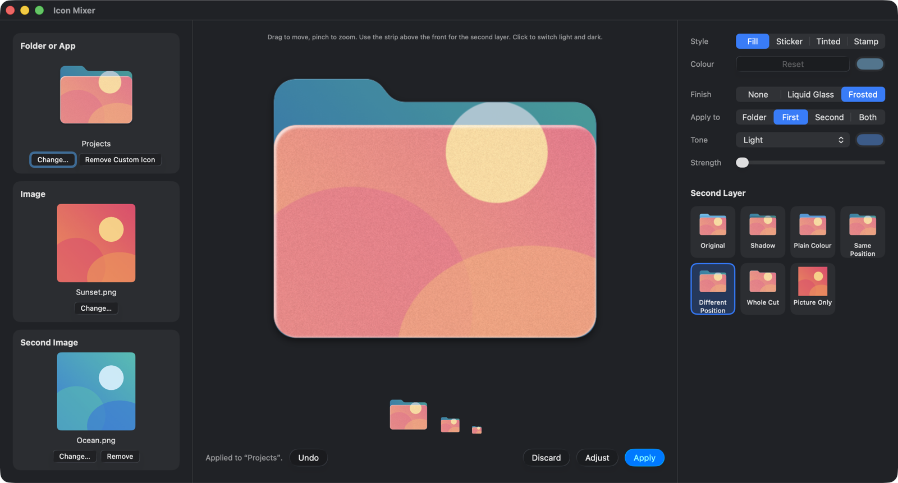

# Icon Mixer

Icon Mixer is a Mac app that puts your own pictures on folder and app icons. Drag in a folder or an app, drag in an image, adjust the preview, and press Apply. Finder shows the new icon.



## Install

You need a Mac with Apple silicon and macOS 14 or later. The app has been tested on macOS 26.

1. Open [`installer/Icon Mixer.dmg`](installer/).
2. Drag Icon Mixer to Applications.
3. Open it from Applications.

The app isn't notarised, so macOS may block it the first time. If it does, go to System Settings > Privacy & Security and choose Open Anyway.

## Change a folder icon

1. Drop a folder on Folder or App, or press Choose.
2. Drop a picture on Image.
3. Pick a style, then press Apply.

Undo puts the previous icon back. Remove Custom Icon returns the folder to its default icon. Discard clears the window and leaves anything already applied in place.

| Style | What it does |
|---|---|
| Fill | The picture covers the front of the folder. |
| Sticker | The picture sits on the folder as a white-bordered card. |
| Tinted | The picture takes on the folder's colour, or one you choose. |
| Stamp | The picture is pressed into the folder like a printed mark. This suits logos and dark-on-light art. |

The Second Layer tiles set what appears behind the front of the folder:

| Tile | What it does |
|---|---|
| Original | Keeps the folder's own back. |
| Shadow | Adds a soft shadow where the front meets the back. It combines with the other tiles. |
| Plain Colour | Fills the back with a colour. |
| Same Position | Carries the picture on into the tab. |
| Different Position | Lets you move the back picture separately. |
| Whole Cut | Cuts the picture to the folder's shape. |
| Picture Only | Uses the image itself as the icon. |

To use a different picture on the second layer, drop it on Second Image.

## Change an app icon

Drop an app on Folder or App. You can then do either of these:

- Add an image and mix it with the app's icon. Fill and Whole Cut trim the picture to the icon's shape, and Sticker places it on top.
- Leave Image empty, pick a finish, and press Apply. The glass goes on the app's original icon. Remove Image takes you back to this after you've added a picture.

Apps have one layer, so the Second Layer options that need a back are dimmed.

Some apps can't be changed. macOS refuses system apps, and apps owned by root may be refused too. For other apps, you may need to turn on Icon Mixer in System Settings > Privacy & Security > App Management.

Quit and reopen an app to see its new icon in the Dock. An app update will probably replace your custom icon. The custom icon also makes a strict code signature check fail, and some apps check themselves when they update, so try it on an app you don't rely on first. Remove Custom Icon takes it off again.

## Finishes

Finish adds a glass surface: Liquid Glass is clear with a lit edge and bends the picture near its edges, and Frosted adds blur, a soft tint and fine grain. Both are drawn into a still image, so they imitate Apple's Liquid Glass and don't react to movement as the real material does.

| Control | What it does |
|---|---|
| Apply to | On a folder, chooses the whole folder as one pane, the first layer, the second layer, or both layers as separate panes. |
| Tone | Light, Dark, Custom, or Auto, which matches your Mac's mode when you press Apply. |
| Strength | Sets the blur and bending. At 0 the picture stays sharp and only the glass surface shows. |

Click the icon in the preview to switch between light and dark glass.

A saved icon is one fixed picture, so it won't change if you switch your Mac between Light and Dark mode later. Press Apply again to update it.

## Move and adjust

Drag the preview to move the picture, and pinch on a trackpad to zoom. On a folder with a picture on its second layer, drag or pinch the strip above the front to change that layer. The front fades to 40% while you do, so you can see behind it.

Adjust opens a panel with a tab for each layer. Each tab has Placement, including Opacity, and Photo controls for brightness, contrast and saturation.

## Things to know

- macOS stores a custom icon in a hidden file named `Icon` inside the folder. It shows up as a new file in `git status` if the folder is a Git repository.
- macOS may ask for permission the first time you use a folder in Desktop, Documents or Downloads.
- If Finder keeps showing an old icon, run `killall Finder`. Don't use Finder's AppleScript `update` command on a folder: on macOS 26 it deletes the folder's custom icon.

## Build from source

You need Xcode, installed at `/Applications/Xcode.app`.

```sh
DEVELOPER_DIR=/Applications/Xcode.app/Contents/Developer swift test
./scripts/build-app.sh --install   # builds the app and copies it to ~/Applications
./scripts/make-installer.sh        # writes installer/Icon Mixer.dmg
```

The image mixing is in `Sources/IconMixCore`, and the app is in `Sources/IconMixer`.

## Contributing

See [CONTRIBUTING.md](CONTRIBUTING.md).

## Release notes

See [RELEASE_NOTES.md](RELEASE_NOTES.md).

## License

See [LICENSE](LICENSE).
